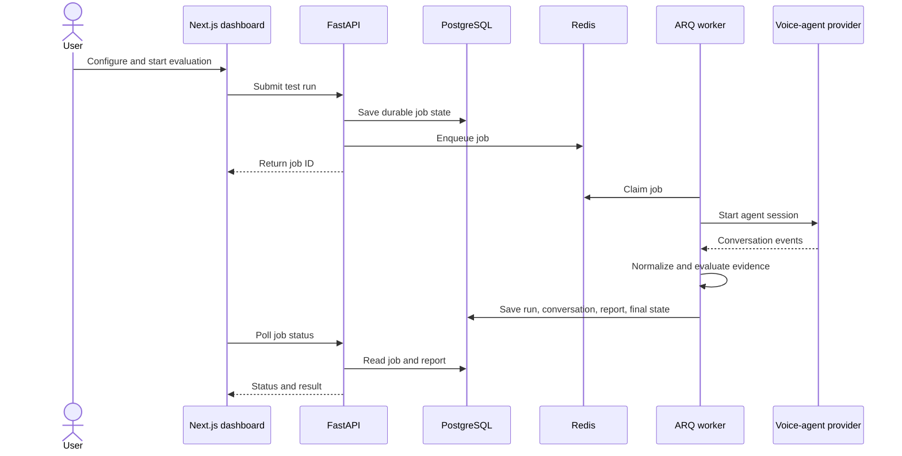

# Novora

Novora is a platform for testing conversational voice agents against business workflows and policy. It runs scripted calls against supported voice-agent providers, evaluates the resulting conversation, and keeps the evidence behind each result so teams can inspect failures and compare runs over time.

This repository contains the FastAPI backend. The dashboard is maintained in the separate [frontend repository](frontend/README.md).

## What works today

- Create evaluation scenarios with explicit goals, criteria, and rules.
- Configure supported voice-agent providers and run scripted tests through the ghost-caller execution pipeline.
- Generate test payloads, execute a call, normalize the conversation, and evaluate its outcome.
- Apply deterministic checks and optional LLM judging. Results keep message-level evidence; missing evidence does not count as a pass.
- Store scenarios, conversations, reports, provider configuration, and job state in PostgreSQL.
- Queue provider evaluations in Redis and track their durable status in PostgreSQL.
- Ingest supported provider webhooks and imported transcripts.
- Compare evaluation runs to find regressions.

The frontend offers the dashboard, scenario and agent setup, run history, evidence inspection, and regression comparison. See [frontend/README.md](frontend/README.md) for its features and local setup.

## System architecture

```mermaid
flowchart LR
    User[User] --> Browser[Novora dashboard]
    Browser --> Next[Next.js web service]
    Next -->|same-origin API proxy| API[FastAPI API]
    API --> PG[(PostgreSQL)]
    API -->|enqueue evaluation job| Redis[(Redis / Render Key Value)]
    Redis --> Worker[Embedded ARQ worker]
    Worker --> Pipeline[Evaluation pipeline]
    Pipeline --> Payload[Test payload generation]
    Payload --> Caller[Ghost caller]
    Caller --> Provider[Voice-agent provider]
    Provider --> Caller
    Caller --> Normalize[Conversation normalization]
    Normalize --> Rules[Deterministic rules]
    Rules --> Judge[Optional LLM judge]
    Judge --> Report[Evidence report]
    Report --> PG
    Next -->|poll job and read results| API
```

The frontend and API are separate web services. The API process currently runs its ARQ worker in the same service process. PostgreSQL and Redis are separate managed services in a Render deployment.

## Runtime and evaluation lifecycle

A user starts an evaluation in the dashboard. The API validates and stores the run request, queues background work in Redis, and returns a job identifier. The dashboard checks job status through the API. The worker performs the provider session and evaluation pipeline, then stores the run, conversation, and report in PostgreSQL. The dashboard reads the saved result and its supporting evidence.

The worker uses at-least-once job execution. If a worker stops after an external provider action but before saving the result, a retry can initiate that action again. Automatic live-provider retries can therefore create another session; use sandbox or test agents when validating retries.

## Data, database, and queue

| Component | Responsibility | Tradeoff |
| --- | --- | --- |
| PostgreSQL | Durable application records, including users, scenarios, conversations, reports, provider integrations, agents, test runs, batches, telephony records, webhook events, and evaluation-job state. | Durable relational storage; some flexible application records are serialized as JSON payloads. |
| Redis / Render Key Value | Short-lived queue transport and worker coordination. | Keeps queued work out of request handling; it is not the durable record of a job or its final result. |
| Browser local storage | Stores the frontend bearer token. | Simple dashboard authentication, but browser JavaScript can read the token. |
| Provider systems | Run agent sessions and return provider events. | External latency, availability, and provider-specific behavior affect a live evaluation. |
| Knowledge stores | No production knowledge retrieval is connected yet. | Phase Two will define authorized sources and retrieval behavior before results depend on external knowledge. |

The backend initializes database tables at startup and includes limited additive column updates for existing evaluation reports. It does not currently use a full migration framework. Plan and review schema changes carefully before production upgrades.

Provider credentials are encrypted before database persistence. The encryption key must remain stable across deployments or existing credentials cannot be decrypted. Keep all secrets in the deployment's secret manager; do not commit local environment files or real credential values.

## Knowledge base: current status and Phase Two

The dashboard's Knowledge Base page is a roadmap screen. It does not collect, index, or retrieve customer documents today. Python interfaces and connector prototypes exist for vector and graph stores, but they use in-memory test data and are not wired into a customer-facing knowledge ingestion or evaluation flow. They should not be treated as production knowledge-base integrations.

Phase Two is planned to add:

1. Authorized, read-only connections to selected customer knowledge sources.
2. Retrieval that can ground evaluation checks in approved policies and facts.
3. Source/version records attached to evaluation results, so changes to a knowledge source can be correlated with changed results.
4. Scoped access, tenant isolation, and protections against unsafe destination URLs and writes.

Phase Two is not part of the current end-to-end product. Until it is implemented, evaluation results do not claim to verify answers against a customer knowledge base.

## Deployment

The backend includes a Dockerfile for a Render Docker Web Service. It binds to 0.0.0.0 and the PORT assigned by Render.

The backend also needs a PostgreSQL database and a Redis-compatible Render Key Value service. Configure NOVORA_DATABASE_URL, REDIS_URL, NOVORA_JWT_SECRET, and NOVORA_SECRET_ENCRYPTION_KEY in Render. Configure the frontend's NEXT_PUBLIC_API_URL with the backend's public HTTPS URL before its Docker build. More detail is in [backend/README.md](backend/README.md) and [frontend/README.md](frontend/README.md).

### Production Deployment

Configure and deploy the backend server to https://backend-qg67.onrender.com. Ensure the frontend connects to this production API URL instead of localhost or development endpoints. Verify that all API requests, authentication flows, environment variables, CORS settings, and backend integrations are correctly configured for production. Ensure the backend service is running and accessible before testing the frontend against the deployed environment.

## Local development

Start with the setup instructions in [backend/README.md](backend/README.md) and [frontend/README.md](frontend/README.md). In short, run PostgreSQL and Redis, configure the backend environment variables locally, start the API on port 8000, then start the dashboard on port 3000.

The API health endpoint is /health; its OpenAPI interface is available at /docs while the backend is running.

## Technical choices

- **Modular monolith:** domain logic, provider adapters, persistence, and HTTP routes live in one Python service. This keeps local development and deployment straightforward while the product's boundaries are still evolving.
- **One API and embedded worker:** avoids operating a second backend service today. Web traffic and worker capacity scale together; later separation may be useful if evaluation volume grows.
- **Redis queue plus PostgreSQL job records:** Redis handles work delivery while PostgreSQL provides durable job status and results. This avoids treating an ephemeral queue as the source of truth.
- **Deterministic checks plus optional LLM judge:** deterministic rules are explainable and repeatable; an LLM judge can cover semantic criteria but adds model cost and variability. The report preserves evidence and limitations so a verdict can be reviewed.
- **Provider adapters:** isolate provider request/response differences behind a shared execution path. Provider rate limits and capabilities still differ.

## Repositories

- [Backend source and API documentation](backend/README.md)
