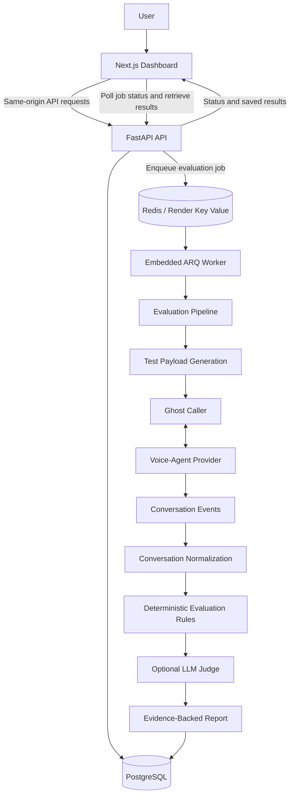
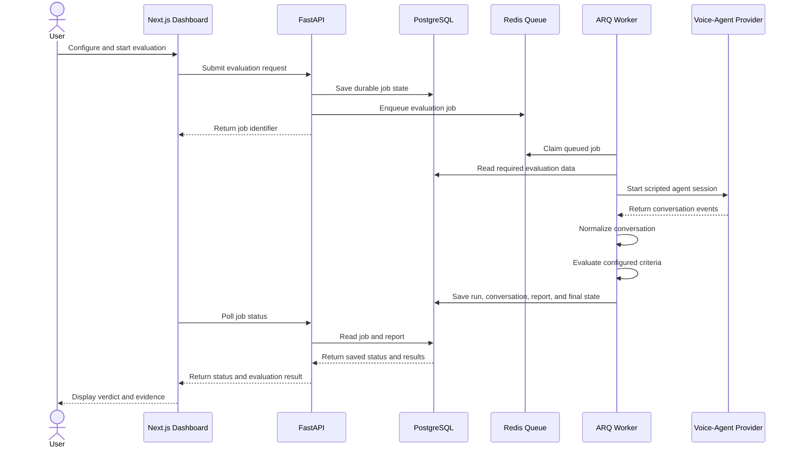
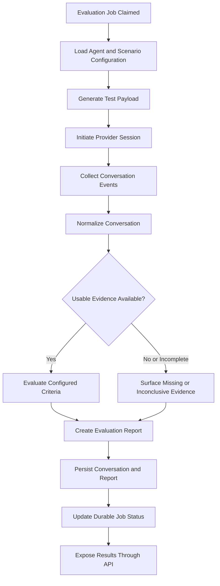
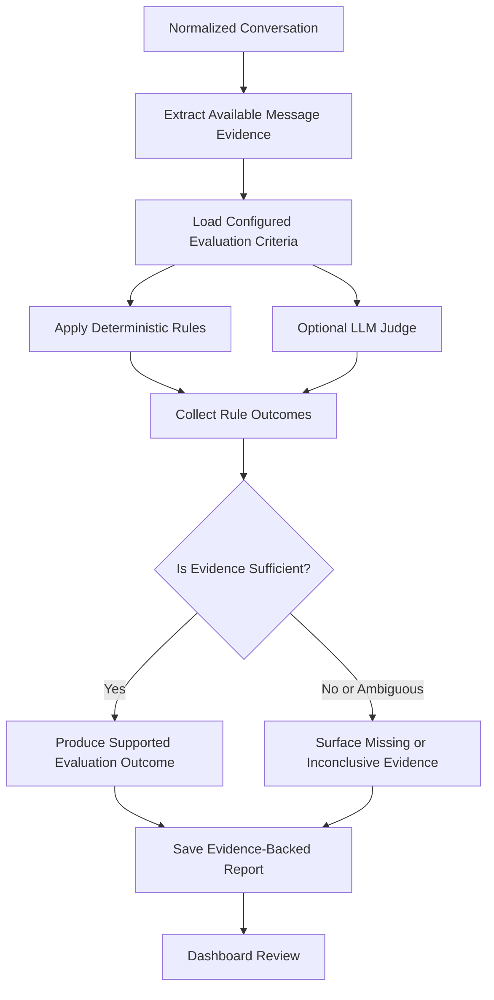
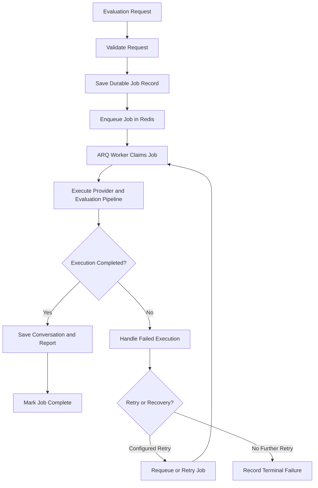
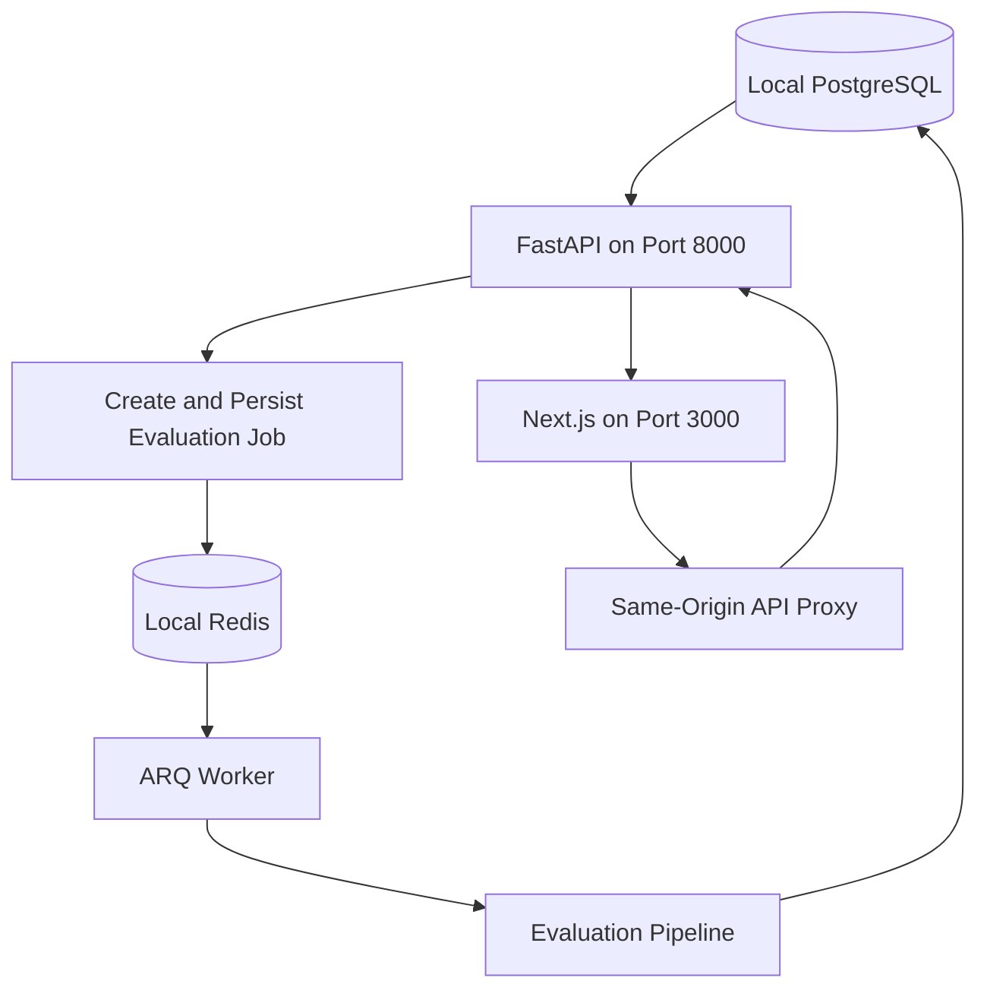
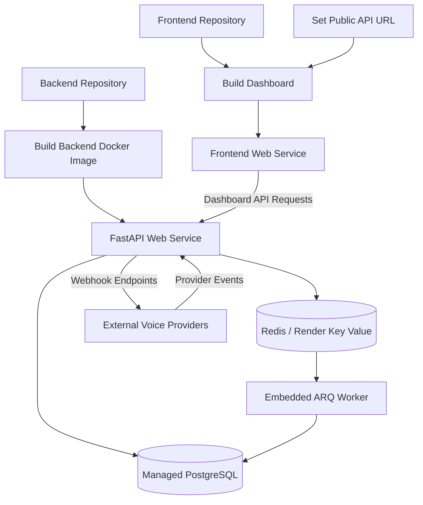

# Novora — Voice AI Evaluation & Regression Monitoring

Novora is a platform for testing conversational voice agents against business workflows and policy. It runs scripted calls against supported voice-agent providers, evaluates the resulting conversations, and preserves the evidence behind each result so teams can inspect failures and compare runs over time.

Rather than judging an agent solely by how fluent it sounds, Novora evaluates whether its behavior satisfies defined business requirements. Teams can configure scenarios and evaluation rules, execute tests, inspect transcript evidence, and investigate regressions between runs.

This repository contains the FastAPI backend. The dashboard is maintained separately and provides the operator interface for configuring agents, creating scenarios, inspecting evaluations, and comparing results.

**Backend API:** [Novora Backend](https://novora-backend-616w.onrender.com)

**Frontend documentation:** [Frontend README](frontend/README.md)

---

## Contents

- [What Works Today](#what-works-today)
- [System Architecture](#system-architecture)
- [Evaluation Lifecycle](#evaluation-lifecycle)
- [Ghost-Caller Execution Pipeline](#ghost-caller-execution-pipeline)
- [Evidence and Verdict Generation](#evidence-and-verdict-generation)
- [Asynchronous Jobs and Recovery](#asynchronous-jobs-and-recovery)
- [Data Model and Infrastructure](#data-model-and-infrastructure)
- [Knowledge Base: Current Status and Phase Two](#knowledge-base-current-status-and-phase-two)
- [Technology Stack](#technology-stack)
- [Repository Structure](#repository-structure)
- [Local Development](#local-development)
- [Configuration and Secrets](#configuration-and-secrets)
- [Deployment](#deployment)
- [Security and Operational Considerations](#security-and-operational-considerations)
- [Engineering Trade-offs](#engineering-trade-offs)
- [Related Repositories and Documentation](#related-repositories-and-documentation)

---

## What Works Today

Novora provides an end-to-end evaluation pipeline for supported conversational voice-agent providers.

### Scenario and agent configuration

- Create evaluation scenarios with explicit goals, criteria, and rules.
- Configure supported voice-agent providers and agents.
- Define scripted test inputs and business expectations.
- Generate test payloads for evaluation execution.

### Evaluation execution

- Execute scripted tests through the ghost-caller pipeline.
- Run provider sessions and collect conversation events.
- Normalize conversations into an evaluation-ready representation.
- Apply deterministic checks and optional LLM judging.
- Preserve message-level evidence supporting evaluation outcomes.

### Results and regression analysis

- Store scenarios, conversations, reports, provider configuration, and job state in PostgreSQL.
- Queue evaluations through Redis and track durable job status in PostgreSQL.
- Ingest supported provider webhooks and imported transcripts.
- Inspect saved evaluation outcomes and supporting evidence.
- Compare evaluation runs to identify regressions and improvements.

### Operator dashboard

The separate frontend provides scenario and agent configuration, evaluation execution, run history, evidence inspection, and regression comparison.

See [frontend/README.md](frontend/README.md) for dashboard capabilities and local setup.

---

## System Architecture

Novora separates the operator interface, API layer, background processing, provider execution, and evaluation logic.

The frontend communicates with FastAPI through a same-origin API proxy. The API persists job state in PostgreSQL and queues evaluation work in Redis. The worker executes provider sessions and the evaluation pipeline, then saves the results for the dashboard to retrieve.



### Component responsibilities

| Component | Responsibility |
|---|---|
| Next.js dashboard | Agent and scenario configuration, evaluation controls, run inspection, and regression comparison |
| FastAPI API | Request validation, application logic, job creation, result retrieval, and provider-facing endpoints |
| PostgreSQL | Durable application records, evaluation reports, and persistent job state |
| Redis / Render Key Value | Queue transport and worker coordination |
| ARQ worker | Executes queued evaluation jobs |
| Ghost caller | Executes the configured scripted provider session through the evaluation pipeline |
| Provider adapters | Handle provider-specific requests, events, and session behavior |
| Conversation normalization | Converts provider conversation data into a consistent evaluation representation |
| Evaluation engine | Applies configured rules and optional LLM-judge criteria |
| Evidence report | Preserves evaluation outcomes and the evidence used to support them |

### Deployment boundaries

The frontend and API are separate web services. PostgreSQL and Redis are separate managed services in the documented Render deployment.

The API process currently runs its ARQ worker in the same service process. This simplifies deployment but means API traffic and worker capacity share the same service-level resources.

---

## Evaluation Lifecycle

An evaluation begins when a user submits a test from the dashboard. The API validates and stores the request, queues background work, and returns a job identifier. The dashboard then checks the job status and retrieves the saved result when processing completes.



### Why the evaluation runs asynchronously

Provider sessions can take time, and evaluation work may involve multiple stages. Processing this work in a background worker prevents the initial API request from having to wait for the entire evaluation to finish.

The API returns a job identifier so the dashboard can follow progress independently of the evaluation request.

PostgreSQL provides the durable application-level record of job status and results. Redis is the queue transport, not the authoritative store for completed evaluation reports.

---

## Ghost-Caller Execution Pipeline

The ghost-caller pipeline connects a configured scenario to a supported external voice agent and produces the conversation data required for evaluation.



### Provider adapters

Provider adapters isolate provider-specific request and response behavior behind a shared execution path. This makes it easier for the evaluation pipeline to work with multiple supported providers without making the entire system dependent on a single provider's session format.

Providers can still differ in session capabilities, rate limits, latency, event formats, and availability. A working integration with one provider does not guarantee identical behavior with another.

---

## Evidence and Verdict Generation

Novora combines deterministic evaluation rules with optional LLM judging.

Deterministic rules evaluate explicit requirements when the available evidence supports the check. Optional LLM judging can handle supported criteria that require semantic interpretation.



### Evaluation principles

**Explicit criteria:** Scenarios define the business requirements the agent is expected to satisfy.

**Evidence-backed results:** Reports preserve message-level evidence so reviewers can investigate why a rule passed or failed.

**No unsupported pass:** Missing evidence does not count as proof of success. Ambiguous or incomplete evidence must be surfaced rather than silently converted into a pass.

**Deterministic checks:** Explicit rules provide repeatable and explainable outcomes when applied to suitable evidence.

**Optional LLM judging:** Model-based evaluation can cover supported semantic criteria, but it adds cost and variability. Its results should be reviewed in the context of the evidence and evaluation configuration.

The evaluation engine is designed to make results inspectable rather than relying only on a final score or a fluent-sounding conversation.

---

## Asynchronous Jobs and Recovery

Novora uses Redis and ARQ to process queued evaluations. Job status and final results are also persisted in PostgreSQL.



### Delivery guarantees and external side effects

The worker uses at-least-once job execution. A failed or interrupted worker may cause a job to be attempted again.

This introduces an important edge case: a worker can stop after initiating an external provider action but before saving the final result. A retry can initiate that action a second time, potentially creating another provider session.

Therefore:

- Do not assume every evaluation job creates exactly one provider session.
- Use sandbox or test agents when validating retry behavior.
- Consider provider-side idempotency support where available.
- Review retry handling before enabling automatic retries against live agents.
- Monitor failed jobs and confirm that their state is reflected in PostgreSQL.

Exactly-once execution of an external provider action is not guaranteed simply because job status is stored durably.

---

## Data Model and Infrastructure

Novora separates durable application records from temporary queue transport and external provider state.

| Component | Responsibility | Trade-off |
|---|---|---|
| PostgreSQL | Stores users, scenarios, conversations, reports, provider configurations, agents, test runs, batches, telephony records, webhook events, and evaluation-job state. | Provides durable relational storage; some flexible application records are serialized as JSON payloads. |
| Redis / Render Key Value | Queue transport and worker coordination. | Keeps queued work out of the request-handling path, but is not the authoritative store for job records or final results. |
| Browser local storage | Stores the frontend bearer token. | Straightforward dashboard authentication, but JavaScript running in the browser can read the token. |
| Provider systems | Execute voice-agent sessions and return provider events. | External latency, outages, rate limits, and provider-specific behavior affect evaluations. |
| Knowledge stores | No production knowledge retrieval is connected yet. | Future retrieval requires authorized data access, source management, and evaluation integration. |

### Database initialization

The backend initializes database tables at startup and includes limited additive column updates for existing evaluation reports.

It does not currently use a full database migration framework.

As a result, schema evolution requires particular care:

- Review changes to existing columns and serialized data structures.
- Back up production data before risky schema changes.
- Keep backend deployments compatible with the database schema they use.
- Plan a migration strategy before introducing more complex schema changes.

Startup table creation and limited column updates should not be treated as a replacement for a complete migration and rollback process.

---

## Knowledge Base: Current Status and Phase Two

The dashboard's Knowledge Base page is a roadmap screen. It does not currently collect, index, or retrieve customer documents.

Python interfaces and connector prototypes exist for vector and graph stores, but they use in-memory test data and are not connected to a customer-facing knowledge ingestion or evaluation workflow.

These prototypes should not be treated as production knowledge-base integrations.

### Planned Phase Two capabilities

1. **Authorized, read-only sources:** Connect selected customer knowledge sources with explicit permissions.
2. **Retrieval-grounded evaluation:** Ground supported checks in approved policies and facts retrieved from authorized sources.
3. **Source and version tracking:** Attach source/version references to evaluation reports so changes in source material can be correlated with changed outcomes.
4. **Tenant isolation:** Ensure customers can access only authorized sources and associated evidence.
5. **Connector safety:** Apply appropriate protections against unsafe destination URLs and unintended write operations.

### Current limitation

Phase Two is not part of the current end-to-end product. Current evaluation results do not claim to verify agent answers against a customer's knowledge base.

Knowledge retrieval should be considered part of the product only when ingestion, authorization, retrieval, evaluation, and evidence tracking work together end to end.

---

## Technology Stack

| Technology / component | Responsibility |
|---|---|
| FastAPI | HTTP API and application request handling |
| Python | Backend application and evaluation logic |
| PostgreSQL | Durable application records, job state, conversations, and reports |
| Redis / Render Key Value | Queued work and worker coordination |
| ARQ | Asynchronous evaluation processing |
| Voice-provider adapters | Provider-specific session execution and event handling |
| Deterministic rules | Explicit, repeatable checks against conversation evidence |
| Optional LLM judge | Model-based evaluation of supported semantic criteria |
| Next.js | Separate operator dashboard |
| Docker | Containerized backend deployment |
| Render | Backend web service and managed infrastructure |

---

## Repository Structure

The backend code lives in the backend repository. The frontend is maintained separately.

A conceptual overview of the backend responsibilities is shown below. Refer to the actual checked-out repository for the precise directory names and complete implementation layout.

```text
backend/
├── app/
│   ├── api/
│   │   ├── routers/
│   │   └── background_tasks/
│   ├── agents/
│   ├── database/
│   ├── services/
│   ├── tests/
│   └── main.py
├── Dockerfile
├── requirements.txt
└── README.md
```

The structure above is illustrative; it does not assert that every listed directory or file exists in every checkout.

### Backend responsibilities

- HTTP routes for users, agents, scenarios, evaluations, and supported provider integrations.
- Evaluation job creation and status tracking.
- Provider session execution and webhook ingestion.
- Conversation normalization and evaluation.
- Persistence of reports, conversations, and evidence.
- Background worker configuration and error handling.

The frontend README documents the dashboard's pages, API proxy, local development, and browser-side authentication.

---

## Local Development

For local development, run PostgreSQL and Redis, configure the backend environment, start the API on port `8000`, and then start the dashboard on port `3000`.

### Prerequisites

- Python and the dependencies specified by the backend project.
- Node.js and npm for the frontend.
- PostgreSQL.
- Redis.
- Credentials for the supported provider integrations you intend to test.

### 1. Configure the backend

Follow the setup instructions in the backend README.

Configure the database URL, Redis URL, JWT secret, secret-encryption key, and any provider-specific credentials needed for your workflows.

### 2. Start the backend

Start the API using the project's documented development command.

The health endpoint is:

`/health`

The interactive OpenAPI documentation is available at:

`/docs`

For a local API running on port `8000`, the usual local URLs are:

- Health check: `http://127.0.0.1:8000/health`
- API documentation: `http://127.0.0.1:8000/docs`

### 3. Start the frontend

Follow the frontend README to install the dependencies and start the dashboard.

Configure its `NEXT_PUBLIC_API_URL` to point to the local backend before starting the Next.js application.

### Local architecture



For exact installation commands and environment variables, consult [backend/README.md](backend/README.md) and [frontend/README.md](frontend/README.md).

---

## Configuration and Secrets

The backend uses environment variables for persistent storage, queued work, authentication, encryption, and provider integration.

The following settings are required by the documented production deployment configuration:

| Variable | Purpose |
|---|---|
| `NOVORA_DATABASE_URL` | PostgreSQL connection string. |
| `REDIS_URL` | Connection string for the Redis-compatible queue service. |
| `NOVORA_JWT_SECRET` | Signing secret for authentication tokens. |
| `NOVORA_SECRET_ENCRYPTION_KEY` | Encryption key used to protect stored provider credentials. |

Other settings may be required by individual providers and features. See the backend configuration and source for the exact provider-specific variable names.

### Secret management

Provider credentials are encrypted before being persisted in the database.

The encryption key must remain stable across deployments. Changing it without an appropriate re-encryption or migration plan can prevent existing credentials from being decrypted.

Follow these rules:

- Keep local environment files out of source control.
- Never commit real credential values.
- Store production secrets in the hosting provider's secret manager.
- Use separate credentials for development and production.
- Restrict access to signing keys and encryption keys.
- Plan key rotation before replacing secrets used to decrypt existing records.

### Frontend configuration

The dashboard's `NEXT_PUBLIC_API_URL` is public configuration. It should contain the backend origin and must never contain API secrets or private credentials.

Because this value is used by the Next.js rewrite configuration, ensure that the frontend build and backend deployment point to the intended environment.

---

## Deployment

The backend includes a Dockerfile for a Render Docker Web Service. It binds to `0.0.0.0` and the `PORT` assigned by the hosting platform.

The deployed backend requires a PostgreSQL database and a Redis-compatible Render Key Value service.

### Deployment architecture



### Production deployment checklist

1. Deploy the backend with the correct Docker configuration.
2. Configure `NOVORA_DATABASE_URL` to use persistent PostgreSQL.
3. Configure `REDIS_URL` to point to the reachable Redis service.
4. Set `NOVORA_JWT_SECRET` and `NOVORA_SECRET_ENCRYPTION_KEY` through the deployment secret manager.
5. Configure any required provider credentials.
6. Confirm that the API binds to the assigned `PORT` and is reachable through its public HTTPS endpoint.
7. Configure the frontend's `NEXT_PUBLIC_API_URL` to point to the intended backend.
8. Ensure provider webhooks target the public backend URL, not the frontend's same-origin proxy.
9. Verify authentication, queue processing, provider sessions, transcript ingestion, and saved evaluation results.
10. Inspect logs for failed jobs, provider errors, and persistence failures.

### Important API hostname check

The deployment notes in the project have referenced two backend hostnames:

- `https://backend-qg67.onrender.com`
- `https://novora-backend-616w.onrender.com`

Before deploying, confirm which hostname is the authoritative production service. The frontend's `NEXT_PUBLIC_API_URL`, the provider webhook configuration, and the backend deployment documentation must point to the intended service.

Do not assume that both hostnames are interchangeable.

### Operational limitations

The API process currently runs the ARQ worker in the same service process. API traffic and worker processing therefore share service resources.

The system uses at-least-once job execution. Retried provider sessions may duplicate external actions if a previous attempt performed the action before failing to persist the result.

Test the deployment using controlled agents and scenarios before using automatic retries against live provider sessions.

---

## Security and Operational Considerations

### Authentication

The frontend stores the short-lived bearer token in browser local storage and attaches it to API requests.

JavaScript running in the page can read this token, so the frontend's dependencies and scripts must be treated as trusted code.

### Credential encryption

Provider credentials are encrypted before database persistence. The encryption key must remain available and stable across deployments unless a deliberate key rotation and re-encryption process is executed.

### Persistent job state

PostgreSQL stores durable job state and evaluation results. Redis is the queue transport and should not be treated as the authoritative record of completed work.

### Provider side effects

A retry can execute a provider session more than once if the earlier attempt reached the provider but failed before the result was saved.

Use test agents to validate retries, and consider provider-supported idempotency mechanisms where available.

### Knowledge access

Production knowledge retrieval is not connected today. Future knowledge integrations must enforce authorization, tenant isolation, source permissions, and protections against unsafe destination URLs and unintended writes.

### Schema evolution

The current database initialization and limited additive updates do not replace a full migration framework. Schema changes require careful review and a plan for compatibility and recovery.

### Monitoring and verification

A healthy HTTP response alone does not prove that evaluation jobs, Redis, PostgreSQL, model providers, or webhook ingestion are working correctly.

Production checks should exercise a representative evaluation from request submission to saved report retrieval.

---

## Engineering Trade-offs

| Decision | Benefit | Trade-off / limitation |
|---|---|---|
| Modular monolith | Keeps domain logic, providers, persistence, and routes in one Python service while product boundaries evolve. | Components share a deployment and runtime; stronger separation may become useful as scale and operational needs grow. |
| API and embedded worker | Avoids operating a second backend service. | Web traffic and worker capacity scale together. Separating the worker may be useful as evaluation volume increases. |
| Redis queue plus PostgreSQL job records | Separates work delivery from durable job status and results. | Requires coordination between queue state, retries, job records, and external side effects. |
| Deterministic checks plus optional LLM judge | Combines explainable rules with semantic evaluation where needed. | Deterministic rules depend on evidence quality; LLM judgments add cost and variability. |
| Provider adapters | Isolates provider-specific behavior behind a common execution path. | Providers differ in capabilities, rate limits, latency, event formats, and reliability. |
| PostgreSQL with JSON payloads | Supports relational records alongside flexible evaluation data. | JSON structures require careful validation and schema-evolution planning. |
| Startup table initialization | Simplifies initial local setup. | It is not a replacement for a complete migration framework for production schema changes. |
| Planned knowledge integrations | Leaves room for retrieval-grounded evaluations in a future phase. | The current product does not provide production customer knowledge retrieval or claim knowledge-grounded verdicts. |

---

## Related Repositories and Documentation

- [Backend source and API documentation](backend/README.md)
- [Frontend dashboard guide](frontend/README.md)
- [Novora production backend](https://novora-backend-616w.onrender.com)

---

## Summary

Novora is built around a practical engineering goal: **make voice-agent behavior testable, explainable, and comparable against business requirements.**

The backend coordinates scripted provider sessions, conversation normalization, evidence-based evaluation, asynchronous processing, persistent reporting, and regression analysis. The frontend gives operators the tools to configure tests, inspect evidence, and compare results.

The current system uses PostgreSQL for durable records and Redis/ARQ for queued evaluation work. Its limitations are documented explicitly: provider retries can repeat external actions, database migrations are not yet managed by a full migration framework, and production knowledge-base retrieval remains planned work.

The objective is to evaluate what an agent actually does, preserve the evidence behind that behavior, and make regressions easier to find before they affect customers.
