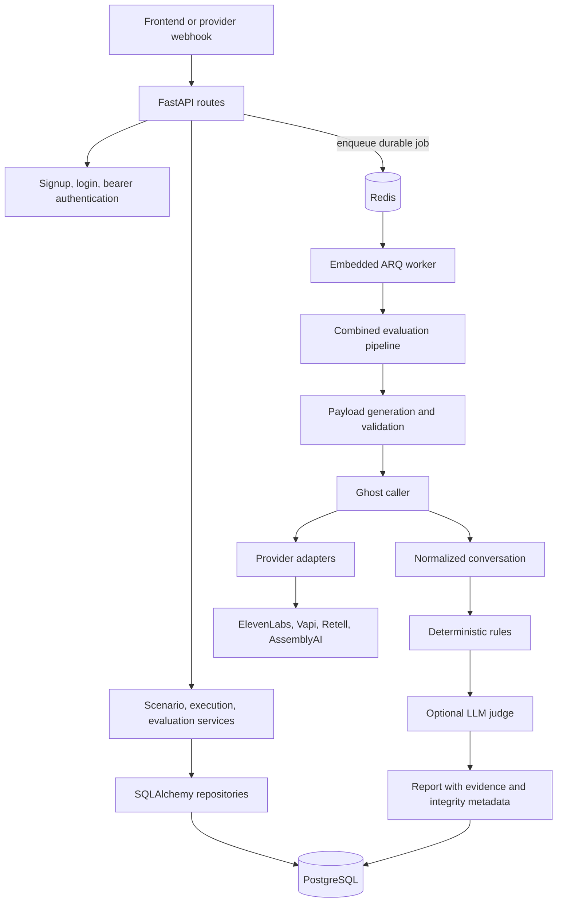

# Novora backend

The backend is a Python modular monolith built with FastAPI. It exposes the API used by the dashboard, normalizes provider conversations, evaluates scenarios, and persists reports with evidence.

## Architecture



### Request and worker runtime

- Synchronous API routes validate requests, persist records, and return responses.
- Provider evaluation jobs are queued through ARQ and Redis. The API starts the ARQ worker as a background task in the same process.
- The worker runs the ghost caller and combined pipeline: construct or validate the test input, execute the provider session, normalize its events, apply evaluation rules, optionally run an LLM judge, and save the result.
- The dashboard polls job state through the API. PostgreSQL stores the job status and result; Redis transports the work.
- The worker retries failed jobs up to ten times after the initial attempt. A retry can repeat an external provider action if the process failed before saving completion, so prefer sandbox agents for retry testing.

This single-process deployment is easier to operate initially. API request load and background evaluation capacity scale together. Running multiple API instances also starts multiple workers on the shared queue, so capacity and provider rate limits should be considered when scaling.

## Persistence and database

PostgreSQL is the durable source of truth for authentication users, scenarios, conversations, evaluation reports, integrations, agents, test cases, test runs, batches, telephony records, webhook events, and evaluation jobs.

Some records use relational columns; flexible application records are stored as serialized JSON payloads through a generic SQLAlchemy record repository. This reduces schema work while models are changing, at the cost of less convenient SQL querying and database-level constraints for those payload fields.

At startup, the service creates missing tables with SQLAlchemy and performs limited additive updates to evaluation-report columns. There is no full migration framework in the current service. Review data compatibility before changing models, and use a deliberate migration plan for production schema evolution.

Provider API keys are encrypted before being stored. Set a stable NOVORA_SECRET_ENCRYPTION_KEY; changing it makes stored credentials unreadable. NOVORA_JWT_SECRET must also be configured and is used to sign bearer tokens.

SQLite is useful for automated tests and local isolated checks. A deployed service should use managed PostgreSQL so data survives container replacement. When the scenario table is empty, startup inserts the built-in starter scenarios; it does not create sample agent or evaluation records.

## Queue and background work

Redis is a job transport, not the persistent database. EvaluationJobState records are saved in PostgreSQL, including status, attempts, failures, and completed output. If a worker restarts, unfinished jobs can be picked up again.

For local development, REDIS_URL can point to a local Redis service. If the default local Redis is unavailable, the backend attempts to start or reuse a Docker container named novora-redis; this local convenience does not apply to Render. In deployment, configure REDIS_URL with the internal connection URL of a managed Redis-compatible service.

ARQ gives at-least-once execution, not exactly-once external effects. A provider call may have started even if the worker did not persist the result before interruption.

## Knowledge base status

Knowledge retrieval is not part of the active API flow. Vector and graph connector protocols and prototype classes are present, but their current storage is in-memory test data; there is no production ingestion, indexing, retrieval API, or connection from retrieved documents to evaluation verdicts. The frontend labels Knowledge Base connectors as planned Phase Two work. Do not configure these prototypes as production integrations.

Phase Two is expected to add approved read-only sources, retrieval grounded in those sources, source/version traceability on reports, and scoped authorization and network protections. Until then, evaluation results are based on the conversation, scenario rules, trusted action records, provider data, and any optional LLM judge—not on customer knowledge-base documents.

## API capabilities

The API currently includes:

- Authentication and current-user endpoints.
- Scenario creation, listing, retrieval, templates, and run history.
- Transcript import and conversation retrieval.
- Synchronous evaluation, evaluation history, and baseline/candidate comparison.
- Provider manifests and provider integrations.
- Agent configuration and connectivity checks.
- Test cases, scripted test runs, batches, and durable evaluation jobs.
- HTTP tool endpoint configuration and deterministic connectivity/evaluation.
- ElevenLabs, Twilio, AssemblyAI, Vapi, and Retell webhook ingestion.
- Health reporting at /health.

OpenAPI documentation is served at /docs while the API is running.

## Local setup

Requirements: Python 3.10 or newer, PostgreSQL, and Redis. For the dashboard, install the frontend separately.

1. Create a PostgreSQL database and a Redis instance.
2. Set these variables in your local environment or secret manager:
   - NOVORA_DATABASE_URL
   - REDIS_URL
   - NOVORA_JWT_SECRET
   - NOVORA_SECRET_ENCRYPTION_KEY
3. Install backend dependencies and start the API:

```sh
cd backend
python -m pip install -r requirements.txt
python -m uvicorn novora.api.main:app --app-dir . --reload --port 8000
```

The API listens locally on http://127.0.0.1:8000. NOVORA_DATABASE_URL must include a SQLAlchemy-compatible PostgreSQL URL, for example a postgresql+psycopg URL. Do not place real secrets in tracked files.

### Run tests

```sh
cd backend
python -m pytest -q
```

The test configuration uses an isolated SQLite database and disables the background worker.

## Render Docker deployment

Create a Render Web Service for this repository, choose Docker, and use the root Dockerfile. The image binds to 0.0.0.0 on Render's PORT, which defaults to 10000.

Provision PostgreSQL and Redis-compatible Key Value separately, then set:

| Variable | Purpose |
| --- | --- |
| NOVORA_DATABASE_URL | PostgreSQL connection URL |
| REDIS_URL | Redis-compatible queue connection URL |
| NOVORA_JWT_SECRET | Random secret for signing access tokens |
| NOVORA_SECRET_ENCRYPTION_KEY | Stable key used to encrypt provider credentials |

Keep the encryption key backed up and unchanged between deploys. Configure provider-specific credentials through the app or deployment's secret manager. Never commit .env, .env.example, credential dumps, or generated local database files.
